# Задание №1. Разработка тем курса «Анализ безопасности автоматизированных систем»

Направление: Государственные информационные системы (ГИС).

Объект защиты: Государственная информационная система предоставления социальных выплат населению.

## 1. Описание объекта защиты

Объект: государственная информационная система предоставления социальных выплат населению.

Назначение: автоматизация приема и обработки заявлений граждан, проверки права на получение социальных выплат, расчета размеров выплат, формирования решений о назначении пособий, учета получателей и информационного взаимодействия с другими государственными системами.

Основной защищаемый процесс: обработка персональных данных граждан и принятие решений о назначении социальных выплат.

### 1.1. Состав объекта защиты

| Компонент                         | Назначение                                                   |
| --------------------------------- | ------------------------------------------------------------ |
| Веб-приложение                    | Прием заявлений, предоставление информации о статусе выплат  |
| Сервер приложений                 | Обработка заявлений, расчет выплат, реализация бизнес-логики |
| Сервер СУБД                       | Хранение персональных данных, сведений о выплатах и решениях |
| Серверы ОС                        | Обеспечение функционирования прикладных компонентов          |
| АРМ сотрудников                   | Рассмотрение заявлений и принятие решений                    |
| Сетевая инфраструктура            | Обмен данными между компонентами ГИС                         |
| Средства защиты информации        | Защита от НСД, вредоносного ПО, сетевых атак и иных угроз    |
| Подсистема резервного копирования | Восстановление данных и работоспособности системы            |

### 1.2. Предварительная классификация

Для рассматриваемой системы предполагается обработка персональных данных граждан, включая сведения о доходах, составе семьи, назначенных пособиях и банковских реквизитах.

Необходимо определить два параметра:

- Класс защищенности ГИС — в соответствии с приложением к Требованиям, утвержденным приказом ФСТЭК России от 11.04.2025 № 117 (в редакции приказа от 08.05.2026 № 137).
- Уровень защищенности персональных данных — в соответствии с постановлением Правительства РФ от 01.11.2012 № 1119.

Окончательные значения определяются по результатам классификации системы и оценки условий обработки ПДн.

## 2. Карта нормативной базы

Обозначения: О — основной документ; В — вспомогательный документ.

### 2.1. Классификация ГИС и определение уровня защищенности

| Тип | Документ | За что отвечает и почему относится к теме |
|---|---|---|
| О | Федеральный закон от 27.07.2006 № 149-ФЗ «Об информации, информационных технологиях и о защите информации» | Правовые основы функционирования государственных информационных систем (ГИС), защиты информации и обязанностей обладателей информации. |
| О | Федеральный закон от 27.07.2006 № 152-ФЗ «О персональных данных» | Правовые основания обработки и обеспечения безопасности персональных данных граждан. |
| О | Приказ ФСТЭК России от 11.04.2025 № 117 «Об утверждении Требований о защите информации, содержащейся в государственных информационных системах, иных информационных системах государственных органов, государственных унитарных предприятий, государственных учреждений» (в ред. приказа ФСТЭК России от 08.05.2026 № 137) | Определение класса защищенности ГИС и требований к защите информации в ней. |
| О | Постановление Правительства РФ от 01.11.2012 № 1119 «Об утверждении требований к защите персональных данных при их обработке в информационных системах персональных данных» | Определение уровня защищенности ПДн с учетом категорий данных, субъектов и условий их обработки, а также актуальных угроз. |
| В | Постановление Правительства РФ от 06.07.2015 № 676 «О требованиях к порядку создания, развития, ввода в эксплуатацию, эксплуатации и вывода из эксплуатации государственных информационных систем и дальнейшего хранения содержащейся в их базах данных информации» | Регулирует этапы жизненного цикла ГИС. Требования к созданию, развитию, эксплуатации и выводу из эксплуатации ГИС. |

Класс защищенности ГИС определяется по характеристикам системы, уровень защищенности ПДн — по условиям обработки персональных данных.

### 2.2. Требования к защите информации и мероприятия по их реализации

| Тип | Документ | За что отвечает и почему относится к теме |
|---|---|---|
| О | Приказ ФСТЭК России от 11.04.2025 № 117 «Об утверждении Требований о защите информации, содержащейся в государственных информационных системах, иных информационных системах государственных органов, государственных унитарных предприятий, государственных учреждений» (в ред. приказа ФСТЭК России от 08.05.2026 № 137) | Основные требования к системе защиты информации ГИС, включая организационные и технические мероприятия. |
| О | Постановление Правительства РФ от 01.11.2012 № 1119 «Об утверждении требований к защите персональных данных при их обработке в информационных системах персональных данных» | Требования к безопасности ПДн при обработке в ИСПДн; применимо к ГИС, в которой обрабатываются персональные данные. |
| В | Приказ ФСТЭК России от 18.02.2013 № 21 «Об утверждении Состава и содержания организационных и технических мер по обеспечению безопасности персональных данных при их обработке в информационных системах персональных данных» | Детализирует меры защиты ПДн в информационных системах персональных данных. Применяется для определения мер защиты персональных данных. |
| В | Методический документ ФСТЭК России от 12.04.2026 «Состав и содержание мероприятий и мер по защите информации, содержащейся в информационных системах» | Состав, содержание и порядок реализации мероприятий и мер защиты информации. |
| В | ГОСТ Р 56939-2024 «Защита информации. Разработка безопасного программного обеспечения. Общие требования» | Требования к процессу безопасной разработки программного обеспечения. |
| В | ГОСТ Р ИСО/МЭК 27001-2021 «Информационная технология. Методы и средства обеспечения безопасности. Системы менеджмента информационной безопасности. Требования» | Требования к системе менеджмента информационной безопасности организации. |

### 2.3. Оценка угроз, анализ защищенности и работа с уязвимостями

| Тип | Документ или ресурс | За что отвечает и почему относится к теме |
|---|---|---|
| О | Методический документ ФСТЭК России от 05.02.2021 «Методика оценки угроз безопасности информации» | Последовательность оценки негативных последствий, источников, способов реализации и актуальности угроз безопасности информации. |
| О | Методический документ ФСТЭК России от 25.11.2025 «Методика анализа защищенности информационных систем» | Организация и проведение анализа уязвимостей, в том числе при аттестационных испытаниях и контроле защищенности. |
| В | Банк данных угроз безопасности информации ФСТЭК России (БДУ ФСТЭК) — https://bdu.fstec.ru/ | Сведения об угрозах безопасности информации и известных уязвимостях. |
| В | ГОСТ Р 56545-2015 «Защита информации. Уязвимости информационных систем. Правила описания уязвимостей» | Правила описания и документирования уязвимостей. |
| В | ГОСТ Р 56546-2015 «Защита информации. Уязвимости информационных систем. Классификация уязвимостей информационных систем» | Классификация уязвимостей по установленным признакам. |
| В | ГОСТ Р 71207-2024 «Защита информации. Разработка безопасного программного обеспечения. Статический анализ программного обеспечения. Общие требования» | Организация статического анализа исходного кода ПО и требования к анализу. |
| В | OWASP Web Security Testing Guide (WSTG) — https://owasp.org/www-project-web-security-testing-guide/ | Методы тестирования безопасности веб-приложений и API. |

### 2.4. Аттестация информационной системы и сертификация средств защиты информации

| Тип | Документ или ресурс | За что отвечает и почему относится к теме |
|---|---|---|
| О | Приказ ФСТЭК России от 29.04.2021 № 77 «Об утверждении Порядка организации и проведения работ по аттестации объектов информатизации на соответствие требованиям о защите информации ограниченного доступа, не составляющей государственную тайну» (в ред. приказа ФСТЭК России от 27.02.2026 № 60) | Порядок проведения аттестации ГИС, состав испытаний и оформление результатов. |
| О | Приказ ФСТЭК России от 03.04.2018 № 55 «Об утверждении Положения о системе сертификации средств защиты информации» (в ред. от 20.01.2026) | Порядок сертификации средств защиты информации. |
| О | Приказ ФСТЭК России от 02.06.2020 № 76 «Об утверждении Требований по безопасности информации, устанавливающих уровни доверия к средствам технической защиты информации и средствам обеспечения безопасности информационных технологий» | Уровни доверия к средствам технической защиты информации и средствам обеспечения безопасности информационных технологий. |
| О | Приказ ФСТЭК России от 11.04.2025 № 117 (в ред. от 08.05.2026 № 137) | Требования к защите информации, на соответствие которым оценивается ГИС. |
| В | Государственный реестр сертифицированных средств защиты информации ФСТЭК России | Проверка сертификатов соответствия СЗИ, их области применения и срока действия. |

### 2.5. Конкретные требования к ОС, СУБД и средствам защиты информации

Документы устанавливают требования безопасности к отдельным видам программного обеспечения и средствам защиты информации.

| Компонент или средство | Точный документ | К чему относится |
|---|---|---|
| Операционная система | Приказ ФСТЭК России от 19.08.2016 № 119, которым утверждены «Требования безопасности информации к операционным системам» | Требования безопасности к операционным системам. Тема № 5. |
| Система управления базами данных | Приказ ФСТЭК России от 14.04.2023 № 64, которым утверждены «Требования по безопасности информации к системам управления базами данных» | Требования безопасности к системам управления базами данных. Тема № 6. |
| Межсетевой экран | Приказ ФСТЭК России от 09.02.2016 № 9, которым утверждены «Требования к межсетевым экранам» | Функции безопасности, типы и классы защиты межсетевых экранов. Темы № 7 и 9. |
| Система обнаружения вторжений | Приказ ФСТЭК России от 06.12.2011 № 638, которым утверждены «Требования к системам обнаружения вторжений» | Функции безопасности и классы защиты систем обнаружения вторжений. Тема № 9. |
| Средство антивирусной защиты | Приказ ФСТЭК России от 20.03.2012 № 28, которым утверждены «Требования к средствам антивирусной защиты» | Функции безопасности и классы защиты антивирусных средств. Тема № 9. |

## 3. Сводная матрица «Тема — нормативные документы»

Документы распределены по темам курса с указанием их назначения.

| № | Тема | Основные документы для темы | Дополнительные документы и ресурсы |
|---|---|---|---|
| 1 | Классификация ГИС | 149-ФЗ (правовой статус ГИС); 152-ФЗ (ПДн); приказ ФСТЭК № 117 от 11.04.2025, ред. № 137 (класс ГИС); ПП РФ № 1119 от 01.11.2012 (уровень защищенности ПДн) | ПП РФ № 676 от 06.07.2015 (создание и эксплуатация ГИС) |
| 2 | Моделирование угроз и анализ защищенности | Приказ ФСТЭК № 117; Методика оценки угроз ФСТЭК от 05.02.2021; Методика анализа защищенности ФСТЭК от 25.11.2025 | БДУ ФСТЭК (источник сведений об угрозах и уязвимостях); ГОСТ Р 56545-2015 (описание); ГОСТ Р 56546-2015 (классификация) |
| 3 | Безопасность разработки ПО | Приказ ФСТЭК № 117; методический документ ФСТЭК от 12.04.2026 (мероприятия и меры защиты) | ГОСТ Р 56939-2024 (процессы безопасной разработки); ГОСТ Р 71207-2024 (статический анализ) |
| 4 | Анализ уязвимостей веб-приложения и API | Приказ ФСТЭК № 117; Методика анализа защищенности от 25.11.2025 | ГОСТ Р 71207-2024 (статический анализ); ГОСТ Р 56545-2015 (описание); ГОСТ Р 56546-2015 (классификация); OWASP WSTG (проверки веб-приложений) |
| 5 | Анализ защищенности ОС | Приказ ФСТЭК № 117; методический документ ФСТЭК от 12.04.2026; Методика анализа защищенности от 25.11.2025 | Приказ ФСТЭК № 119 от 19.08.2016 (требования безопасности к ОС); БДУ ФСТЭК; документация ОС по безопасной настройке |
| 6 | Анализ безопасности СУБД | 152-ФЗ; ПП РФ № 1119; приказ ФСТЭК № 117; Методика анализа защищенности от 25.11.2025 | Приказ ФСТЭК № 21 от 18.02.2013 (меры защиты ПДн); приказ ФСТЭК № 64 от 14.04.2023 (требования безопасности к СУБД); документация PostgreSQL |
| 7 | Анализ сетевой сегментации | Приказ ФСТЭК № 117; методический документ ФСТЭК от 12.04.2026; Методика анализа защищенности от 25.11.2025 | Приказ ФСТЭК № 9 от 09.02.2016 (требования к межсетевым экранам); документация применяемого МЭ |
| 8 | Анализ внешних соединений | 149-ФЗ; 152-ФЗ (при передаче ПДн); приказ ФСТЭК № 117; Методика оценки угроз от 05.02.2021 | Методика анализа защищенности от 25.11.2025; методический документ ФСТЭК от 12.04.2026; приказ ФСТЭК № 9 (при оценке МЭ) |
| 9 | Оценка соответствия и эффективности СЗИ | Приказ ФСТЭК № 117 (необходимые функции защиты); приказ ФСТЭК № 55 от 03.04.2018 (сертификация СЗИ); приказ ФСТЭК № 76 от 02.06.2020 (уровни доверия) | Приказы ФСТЭК № 9 (МЭ), № 638 (СОВ), № 28 (антивирус), № 119 (ОС), № 64 (СУБД); реестр сертифицированных СЗИ ФСТЭК |
| 10 | Контроль защищенности и аттестация | Приказ ФСТЭК № 117; приказ ФСТЭК № 77 от 29.04.2021, ред. № 60 (аттестация); Методика анализа защищенности от 25.11.2025 | Методический документ ФСТЭК от 12.04.2026; ГОСТ Р 56545-2015 и ГОСТ Р 56546-2015 (документирование уязвимостей) |

## 4. Дерево нормативной базы

Дерево нормативной базы по направлениям защиты информации в ГИС социальных выплат.

```mermaid
flowchart LR
    ROOT["Нормативная база<br/>ГИС социальных выплат"]

    ROOT --> LAW["Правовые основы<br/>и жизненный цикл ГИС"]
    ROOT --> PROTECT["Защита информации<br/>в ГИС и ПДн"]
    ROOT --> AUDIT["Оценка угроз<br/>и анализ защищенности"]
    ROOT --> ASSESS["Аттестация ГИС<br/>и сертификация СЗИ"]
    ROOT --> PRODUCTS["Требования к отдельным<br/>ОС, СУБД и СЗИ"]
    ROOT --> STANDARDS["Стандарты и<br/>практические руководства"]

    LAW --> F149["149-ФЗ от 27.07.2006<br/>Об информации"]
    LAW --> F152["152-ФЗ от 27.07.2006<br/>О персональных данных"]
    LAW --> P676["ПП РФ № 676 от 06.07.2015<br/>Создание и эксплуатация ГИС"]

    PROTECT --> F117["Приказ ФСТЭК № 117 от 11.04.2025<br/>ред. № 137 от 08.05.2026<br/>Защита информации и класс ГИС"]
    PROTECT --> P1119["ПП РФ № 1119 от 01.11.2012<br/>Уровни защищенности ПДн"]
    PROTECT --> F21["Приказ ФСТЭК № 21 от 18.02.2013<br/>Организационные и технические<br/>меры защиты ПДн"]
    PROTECT --> M2026["Документ ФСТЭК от 12.04.2026<br/>Состав и содержание<br/>мер защиты информации"]

    AUDIT --> TH2021["Методика ФСТЭК от 05.02.2021<br/>Оценка угроз безопасности"]
    AUDIT --> AZ2025["Методика ФСТЭК от 25.11.2025<br/>Анализ защищенности ИС"]
    AUDIT --> BDU["БДУ ФСТЭК<br/>Справочник угроз и уязвимостей"]

    ASSESS --> AT77["Приказ ФСТЭК № 77 от 29.04.2021<br/>ред. № 60 от 27.02.2026<br/>Аттестация объектов информатизации"]
    ASSESS --> CERT55["Приказ ФСТЭК № 55 от 03.04.2018<br/>Система сертификации СЗИ"]
    ASSESS --> TRUST76["Приказ ФСТЭК № 76 от 02.06.2020<br/>Уровни доверия средств защиты"]
    ASSESS --> REG["Реестр сертифицированных СЗИ<br/>Справочный ресурс ФСТЭК"]

    PRODUCTS --> OS119["Приказ ФСТЭК № 119 от 19.08.2016<br/>Требования к операционным системам"]
    PRODUCTS --> DB64["Приказ ФСТЭК № 64 от 14.04.2023<br/>Требования к СУБД"]
    PRODUCTS --> FW9["Приказ ФСТЭК № 9 от 09.02.2016<br/>Требования к межсетевым экранам"]
    PRODUCTS --> IDS638["Приказ ФСТЭК № 638 от 06.12.2011<br/>Требования к системам<br/>обнаружения вторжений"]
    PRODUCTS --> AV28["Приказ ФСТЭК № 28 от 20.03.2012<br/>Требования к средствам<br/>антивирусной защиты"]

    STANDARDS --> F162["162-ФЗ от 29.06.2015<br/>Правовые основы стандартизации"]
    STANDARDS --> GDEV["ГОСТ Р 56939-2024<br/>Безопасная разработка ПО"]
    STANDARDS --> GSTATIC["ГОСТ Р 71207-2024<br/>Статический анализ ПО"]
    STANDARDS --> GVULN["ГОСТ Р 56545-2015<br/>Описание уязвимостей"]
    STANDARDS --> GCLASS["ГОСТ Р 56546-2015<br/>Классификация уязвимостей"]
    STANDARDS --> G27001["ГОСТ Р ИСО/МЭК 27001-2021<br/>Менеджмент ИБ организации"]
    STANDARDS --> OWASP["OWASP WSTG<br/>Дополнительное руководство<br/>по тестированию веб-приложений"]

    classDef main fill:#e2e8f0,stroke:#475569,color:#0f172a
    classDef law fill:#dbeafe,stroke:#2563eb,color:#172554
    classDef regulation fill:#dcfce7,stroke:#16a34a,color:#14532d
    classDef method fill:#fef3c7,stroke:#d97706,color:#78350f
    classDef standard fill:#f3e8ff,stroke:#9333ea,color:#581c87
    class ROOT,LAW,PROTECT,AUDIT,ASSESS,PRODUCTS,STANDARDS main
    class F149,F152,F162 law
    class P676,F117,P1119,F21,AT77,CERT55,TRUST76,OS119,DB64,FW9,IDS638,AV28 regulation
    class M2026,TH2021,AZ2025,BDU,REG method
    class GDEV,GSTATIC,GVULN,GCLASS,G27001,OWASP standard
```

### Условные обозначения

- Серый: тематические группы и объект изучения.
- Синий: федеральные законы.
- Зеленый: постановления Правительства РФ и приказы ФСТЭК России.
- Желтый: методические документы и справочные ресурсы ФСТЭК России.
- Фиолетовый: национальные стандарты и международное практическое руководство OWASP WSTG.
- Стрелка: принадлежность документа к тематической группе.

## 5. Сведения об использовании ИИ

{При подготовке перечня тем курса, уточнении нормативной базы, составлении таблиц и построении дерева нормативных документов использовался ChatGPT (OpenAI, модель GPT-6).}

