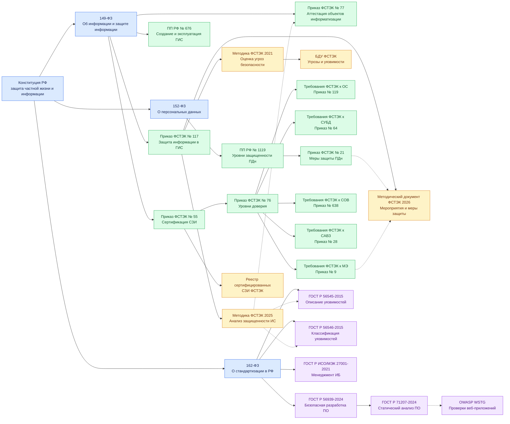

# Задание №1. Разработка тем курса «Анализ безопасности автоматизированных систем»

Направление: Государственные информационные системы (ГИС).

Объект защиты: Государственная информационная система предоставления социальных выплат населению.

## 1. Описание объекта защиты

Объект: государственная информационная система предоставления социальных выплат населению.

Назначение: автоматизация приема и обработки заявлений граждан, проверки права на получение социальных выплат, расчета размеров выплат, формирования решений о назначении пособий, учета получателей и информационного взаимодействия с другими государственными системами.

Основной защищаемый процесс: обработка персональных данных граждан и принятие решений о назначении социальных выплат.

### 1.1. Состав объекта защиты

| Компонент                         | Назначение                                                   |
| --------------------------------- | ------------------------------------------------------------ |
| Веб-приложение                    | Прием заявлений, предоставление информации о статусе выплат  |
| Сервер приложений                 | Обработка заявлений, расчет выплат, реализация бизнес-логики |
| Сервер СУБД                       | Хранение персональных данных, сведений о выплатах и решениях |
| Серверы ОС                        | Обеспечение функционирования прикладных компонентов          |
| АРМ сотрудников                   | Рассмотрение заявлений и принятие решений                    |
| Сетевая инфраструктура            | Обмен данными между компонентами ГИС                         |
| Средства защиты информации        | Защита от НСД, вредоносного ПО, сетевых атак и иных угроз    |
| Подсистема резервного копирования | Восстановление данных и работоспособности системы            |

### 1.2. Предварительная классификация

Для рассматриваемой системы предполагается обработка персональных данных граждан, включая сведения о доходах, составе семьи, назначенных пособиях и банковских реквизитах.

Необходимо определить два параметра:

- Класс защищенности ГИС — в соответствии с применимыми требованиями ФСТЭК к государственным информационным системам.
- Уровень защищенности персональных данных — по постановлению Правительства РФ № 1119.

Окончательные значения определяются по результатам классификации системы и оценки условий обработки ПДн.

## 2. Карта нормативной базы

Обозначения: О — основной документ, В — вспомогательный документ.

### 2.1. Классификация ГИС и определение уровня защищенности

| Тип | Документ                                                           | Назначение                                                                 |
| --- | ------------------------------------------------------------------ | -------------------------------------------------------------------------- |
| О   | Федеральный закон № 149-ФЗ от 27.07.2006                           | Правовые основы функционирования ГИС и защиты информации                   |
| О   | Федеральный закон № 152-ФЗ от 27.07.2006                           | Правовые основы обработки и защиты персональных данных                     |
| О   | Приказ ФСТЭК России № 117 от 11.04.2025 (с изменениями) | Классификация ГИС, определение требований к защите информации              |
| О   | Постановление Правительства РФ № 1119 от 01.11.2012                | Определение уровней защищенности персональных данных                       |
| В   | Постановление Правительства РФ № 676 от 06.07.2015                 | Требования к созданию, развитию и эксплуатации ГИС в установленных случаях |

Приказ ФСТЭК России № 117 является основным документом для определения требований к защите информации в рассматриваемой ГИС.&#x20;

### 2.2. Требования по защите информации

| Тип | Документ                                                                                                                                       | Назначение                                                                       |
| --- | ---------------------------------------------------------------------------------------------------------------------------------------------- | -------------------------------------------------------------------------------- |
| О   | Приказ ФСТЭК № 117 от 11.04.2025                                                                                                               | Требования к защите информации в ГИС, включая организационные и технические меры |
| О   | Приказ ФСТЭК № 21 от 18.02.2013                                                                                                                | Организационные и технические меры по защите ПДн в ИСПДн                         |
| О   | Постановление Правительства РФ № 1119                                                                                                          | Требования к защите ПДн по установленным уровням защищенности                    |
| В   | Методический документ ФСТЭК от 12.04.2026 «Состав и содержание мероприятий и мер по защите информации, содержащейся в информационных системах» | Детализация мероприятий и мер защиты                                             |
| В   | ГОСТ Р 56939-2024                                                                                                                              | Организация безопасной разработки программного обеспечения                       |
| В   | ГОСТ Р ИСО/МЭК 27001-2021                                                                                                                      | Требования к системе менеджмента информационной безопасности                     |

Методический документ от 12.04.2026 следует использовать в связке с приказом № 117 для детализации технических мер.&#x20;

### 2.3. Анализ безопасности и аудит

| Тип | Документ                                                                | Назначение                                               |
| --- | ----------------------------------------------------------------------- | -------------------------------------------------------- |
| О   | Методика оценки угроз безопасности информации ФСТЭК от 05.02.2021       | Определение актуальных угроз безопасности ГИС            |
| О   | Методика анализа защищенности информационных систем ФСТЭК от 25.11.2025 | Организация и проведение анализа защищенности            |
| О   | Банк данных угроз безопасности информации ФСТЭК (БДУ)                   | Поиск известных угроз и уязвимостей                      |
| В   | ГОСТ Р 56545-2015                                                       | Классификация уязвимостей информационных систем          |
| В   | ГОСТ Р 56546-2015                                                       | Выявление и устранение уязвимостей                       |
| В   | ГОСТ Р 71207-2024                                                       | Статический анализ программного обеспечения              |
| В   | OWASP Web Security Testing Guide                                        | Практические методы проверки безопасности веб-приложений |

Методика ФСТЭК от 25.11.2025 непосредственно связана с анализом защищенности в рамках испытаний систем защиты информации.&#x20;

### 2.4. Аттестация и сертификация

| Тип | Документ                                                               | Назначение                                                       |
| --- | ---------------------------------------------------------------------- | ---------------------------------------------------------------- |
| О   | Приказ ФСТЭК № 77 от 29.04.2021, в редакции приказа № 60 от 27.02.2026 | Порядок аттестации объектов информатизации                       |
| О   | Приказ ФСТЭК № 55 от 03.04.2018                                        | Порядок сертификации средств защиты информации                   |
| О   | Приказ ФСТЭК № 76 от 02.06.2020                                        | Требования к уровням доверия средств защиты                      |
| О   | Приказ ФСТЭК № 117                                                     | Требования к защите информации и оценке соответствия ГИС         |
| В   | Требования ФСТЭК к конкретным типам СЗИ и профили защиты               | Оценка соответствия МЭ, СОВ, антивирусов и других средств защиты |
| В   | Государственный реестр сертифицированных СЗИ ФСТЭК                     | Проверка наличия и действительности сертификатов                 |

При проведении аттестации необходимо учитывать действующую редакцию приказа ФСТЭК России № 77.&#x20;

## 3. Перечень тем курса

Курс включает 10 тем, распределенных по пяти разделам в соответствии с направлениями анализа безопасности автоматизированных систем.

| №  | Раздел                      | Тема                                                                                  |
| -- | --------------------------- | ------------------------------------------------------------------------------------- |
| 1  | АБАС                        | Классификация ГИС социальных выплат и определение требований к защите информации      |
| 2  | АБАС                        | Моделирование угроз и комплексный анализ защищенности ГИС социальных выплат           |
| 3  | Анализ безопасности РПО     | Анализ безопасности процессов разработки и сопровождения ПО ГИС                       |
| 4  | Анализ безопасности РПО     | Анализ уязвимостей веб-приложения и программных интерфейсов API                       |
| 5  | Анализ безопасности ОС и БД | Анализ защищенности серверных операционных систем ГИС                                 |
| 6  | Анализ безопасности ОС и БД | Анализ безопасности СУБД и защиты персональных данных получателей выплат              |
| 7  | Анализ безопасности сети    | Анализ сегментации сети и защищенности сетевого взаимодействия компонентов ГИС        |
| 8  | Анализ безопасности сети    | Анализ безопасности внешних соединений, межсистемного обмена и удаленного доступа     |
| 9  | Анализ безопасности СЗИ     | Анализ соответствия применяемых СЗИ нормативным требованиям и оценка их эффективности |
| 10 | Анализ безопасности СЗИ     | Комплексный контроль защищенности ГИС и подготовка к аттестации                       |

## 4. Сводная матрица «Тема — нормативные документы»

Эта таблица показывает, какие документы обосновывают включение каждой темы в курс.

| №  | Тема (сокращенно)                         | Основные документы                                                              | Вспомогательные документы                                          |
| -- | ----------------------------------------- | ------------------------------------------------------------------------------- | ------------------------------------------------------------------ |
| 1  | Классификация ГИС                         | 149-ФЗ, 152-ФЗ, ФСТЭК № 117, ПП № 1119                                          | ПП № 676                                                           |
| 2  | Моделирование угроз и анализ защищенности | ФСТЭК № 117, Методика оценки угроз (2021), Методика анализа защищенности (2025) | БДУ ФСТЭК, ГОСТ Р 56545                                            |
| 3  | Безопасность разработки ПО                | ФСТЭК № 117                                                                     | ГОСТ Р 56939-2024                                                  |
| 4  | Анализ уязвимостей веб-приложения         | ФСТЭК № 117, Методика анализа защищенности (2025)                               | ГОСТ Р 71207-2024, OWASP WSTG                                      |
| 5  | Анализ защищенности ОС                    | ФСТЭК № 117, Методика анализа защищенности (2025)                               | БДУ ФСТЭК, рекомендации по безопасной конфигурации ОС              |
| 6  | Анализ безопасности СУБД                  | ФСТЭК № 117, ФСТЭК № 21, Методика анализа защищенности (2025)                   | Требования ФСТЭК к СУБД, ГОСТ Р 56546                              |
| 7  | Анализ сетевой сегментации                | ФСТЭК № 117, Методика анализа защищенности (2025)                               | ГОСТ Р ИСО/МЭК 27001                                               |
| 8  | Анализ внешних соединений                 | ФСТЭК № 117, Методика оценки угроз (2021)                                       | Методика анализа защищенности (2025), рекомендации по настройке МЭ |
| 9  | Оценка соответствия и эффективности СЗИ   | ФСТЭК № 117, ФСТЭК № 55, ФСТЭК № 76                                             | Требования и профили защиты СЗИ, реестр ФСТЭК                      |
| 10 | Контроль защищенности и аттестация        | ФСТЭК № 117, ФСТЭК № 77 (ред. № 60)                                             | Методика анализа защищенности (2025), ГОСТ Р 56546                 |

## 5. Дерево нормативной базы

Дерево отражает уровни нормативного регулирования и тематическую детализацию требований применительно к ГИС предоставления социальных выплат населению. Сплошные стрелки показывают связь общего регулирования с более специальными документами и методиками; они не всегда означают прямое юридическое подчинение или издание документа во исполнение другого. Пунктирные стрелки обозначают дополнительные методические связи. 

### Условные обозначения

- **Синий:** конституционные и законодательные основы.
- **Зеленый:** постановления Правительства РФ и нормативные требования ФСТЭК.
- **Желтый:** методические документы и справочные ресурсы ФСТЭК.
- **Фиолетовый:** национальные стандарты и вспомогательные методики.
- **Сплошная стрелка:** переход от общего документа к тематически связанному специальному документу.
- **Пунктирная стрелка:** дополнительная связь между документами, применяемыми совместно.

